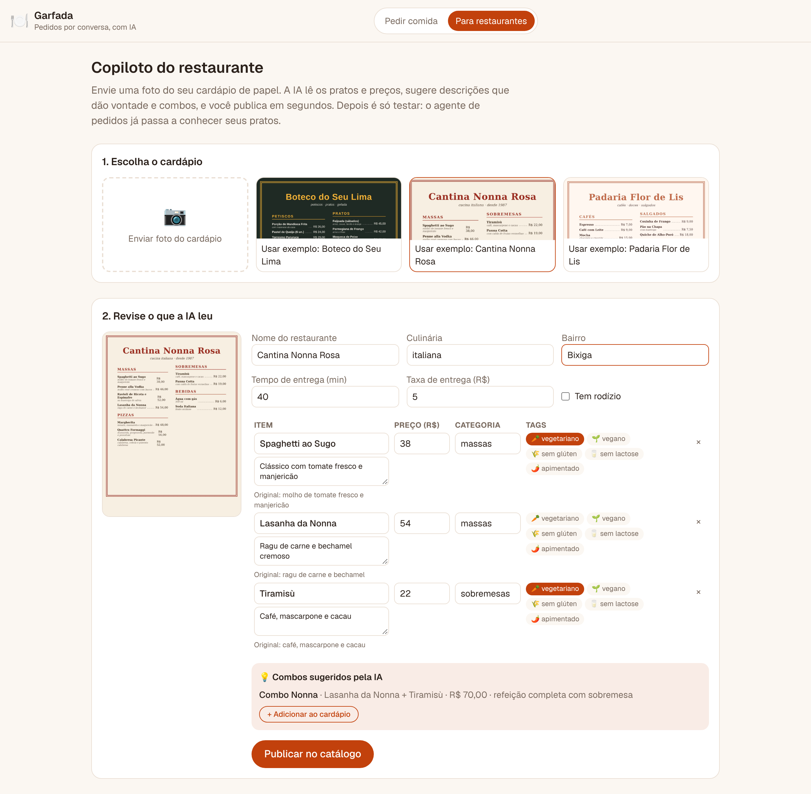

# 🍽️ Garfada: pedidos de comida por conversa, com IA


[](COLOQUE-O-LINK-AQUI)

Protótipo de **IA generativa aplicada a delivery**, com os dois lados do marketplace:

- **🧑 Cliente: agente de pedidos.** Você conversa como com um amigo: *"sou vegetariana, quero uma massa até R$ 50"*. O agente busca no catálogo, **lembra suas restrições**, monta o **carrinho** e mostra **como pensou** em cada passo.
- **👩‍🍳 Restaurante: copiloto de cardápio.** O dono envia a **foto do cardápio de papel**. A IA extrai pratos, preços, categorias e tags (vegano, sem glúten…), reescreve as descrições, sugere combos e publica. **Na hora, o agente do cliente já recomenda esses pratos.**

### 🔗 Demo ao vivo: https://garfada-three.vercel.app/

| Agente de pedidos | Celular |
|---|---|
|  |  |



## ⏱️ Teste em 2 minutos

1. Na aba **Pedir comida**, escreva: *"Sou vegetariana e não como cogumelo. Quero uma massa até R$ 50"*.
   Repare no painel **"O que a IA lembra de você"** e abra **"Como a IA pensou"** para ver as ferramentas chamadas.
2. Escreva: *"Coloca 2 da primeira opção no carrinho"*. O agente entende a referência e monta o pedido com o total.
3. Vá em **Para restaurantes**, clique em **Usar exemplo: Cantina Nonna Rosa**, revise o que a IA leu e clique em **Publicar no catálogo**.
4. Volte ao chat e peça *"um spaghetti"*: o prato que acabou de ser lido da foto já aparece nas recomendações.

## 🧠 O que tem de GenAI aqui

| Técnica | Onde | Por quê |
|---|---|---|
| **Agente com function calling** | `src/lib/agent/` | O Gemini decide quais das 9 ferramentas chamar (buscar pratos, ver cardápio, salvar preferência, adicionar ao carrinho…) num loop de até 6 passos. |
| **Guardrails no código, não só no prompt** | `tools.ts`, `cart.ts`, `validate.ts` | As restrições filtram os resultados no código, inclusive no plural ("camarões" bloqueia "camarão") e em grupos como "frutos do mar". O carrinho aceita só um restaurante, e os preços são **recalculados no servidor** a partir do catálogo. |
| **Memória de preferências** | `AgentState` | Dieta, ingredientes a evitar e gostos acompanham a conversa. O cliente vê e edita essas preferências no painel. |
| **Visão + saída estruturada** | `src/lib/menu/extract.ts` | Foto → JSON com `responseSchema`, depois uma normalização defensiva (preço, tags, vegano ⇒ vegetariano, limites de tamanho). |
| **Evals com a API real** | `evals/` | 11 cenários: preço máximo, dieta, ingrediente proibido (inclusive no plural), rodízio, tempo de entrega, referência a "esse/o primeiro", um restaurante por pedido, fora do tema, não inventar prato e orçamento. **Resultado: 11/11** ([evals/RESULTS.md](evals/RESULTS.md)). |
| **Transparência** | "Como a IA pensou" | Cada resposta mostra as ferramentas, os argumentos e o resultado, em tempo real (streaming NDJSON). |
| **Defesa contra prompt injection** | `validate.ts`, `prompt.ts` | Textos de cardápios importados e de preferências são sanitizados e vão para o modelo como **bloco JSON de dados**, não como instrução. |
| **Resiliência e custo** | `src/lib/ai/models.ts` | Modelo reserva automático em caso de sobrecarga, timeout ou cota por minuto; prazo de 45 s por turno; rate limit por IP. Roda **100% no free tier** do Gemini. |

## 🏗️ Arquitetura

```
             Pedir comida (/)                               Para restaurantes (/restaurante)
  ┌──────────────────────────────────┐              ┌──────────────────────────────────────┐
  │ Chat · cards · carrinho · prefs  │              │ foto → revisão (tabela) → publicar   │
  └──────────────┬───────────────────┘              └──────────────┬───────────────────────┘
                 │ mensagens + estado + restaurantes importados     │ imagem (redimensionada no navegador)
                 ▼                                                  ▼
        POST /api/chat (NDJSON)                            POST /api/menu
   valida · rate limit · recalcula carrinho            valida · rate limit
                 │                                                  │
                 ▼                                                  ▼
   ┌── loop do agente (≤ 6 passos) ──┐                  Gemini (visão + JSON schema)
   │ Gemini ⇄ ferramentas no código  │                              │
   │  buscar_pratos · ver_cardapio   │                              ▼
   │  salvar_preferencia · carrinho… │                  rascunho normalizado do cardápio
   └─────────────────────────────────┘                  → salvo no navegador (localStorage)
     eventos: tool · dishes · state · text · done        → enviado junto com cada mensagem do chat
```

- **Catálogo:** 12 restaurantes **fictícios** em bairros reais de São Paulo (`src/data/catalog.ts`), mais os que você publicar pelo copiloto.
- **Sem banco de dados:** o estado da conversa vive no cliente e o servidor valida tudo a cada requisição. O deploy fica gratuito e simples; num produto real, esse estado iria para um banco.

## ⚖️ Decisões e trade-offs

- **Busca por palavra-chave em vez de embeddings.** Para 12 restaurantes, basta e não gasta cota; o próprio agente expande sinônimos na consulta.
- **Resposta final sem streaming de tokens.** O loop precisa da resposta completa para decidir se chama ferramentas. Em troca, os passos chegam ao vivo.
- **`gemini-3.5-flash-lite` como padrão**, com `gemini-3.5-flash` de reserva. Foi a combinação mais estável no free tier nos testes.
- **Restrições por texto.** Funcionam para plural e grupos comuns. Um produto real usaria alérgenos estruturados no cardápio.

## 💻 Rodando localmente

Pré-requisitos: Node 20+ e uma chave gratuita do [Google AI Studio](https://aistudio.google.com/apikey).

```bash
npm install
cp .env.example .env.local   # coloque sua GEMINI_API_KEY (no Windows: copy .env.example .env.local)
npm run dev                  # http://localhost:3000
```

## 🧪 Testes

```bash
npm test                          # 112 testes unitários e de componentes (Vitest + Testing Library)
npx playwright install chromium   # só na primeira vez
npx playwright test               # ponta a ponta (desktop e celular), com a API simulada
npm run evals                     # qualidade do agente com o Gemini real (precisa de GEMINI_API_KEY)
```

## 🚀 Deploy (grátis na Vercel)

1. Importe o repositório em [vercel.com/new](https://vercel.com/new).
2. Em *Environment Variables*, defina `GEMINI_API_KEY`.
3. Deploy. 🎉

## 🔭 Próximos passos

- Busca semântica (embeddings) e ranking personalizado pelo histórico de pedidos.
- Alérgenos estruturados no cardápio.
- Pedido por voz (o Gemini aceita áudio).
- Persistência real (banco + login) e painel do restaurante com perguntas sobre vendas.

## 🛠️ Stack

Next.js · React · TypeScript · Tailwind CSS · Google Gen AI SDK (`@google/genai`) · Vitest · Testing Library · Playwright

---

*Projeto pessoal de portfólio, inspirado em assistentes de pedido por conversa. Restaurantes, pratos e preços são fictícios; nenhum pagamento é processado.*
