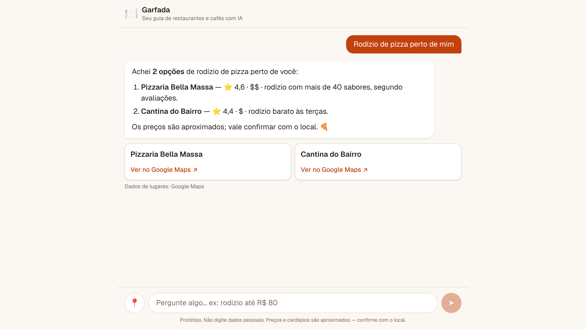
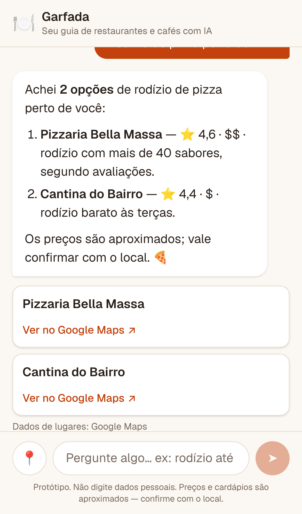

# 🍽️ Garfada: restaurantes e cafés com IA

Chat em português que encontra **restaurantes e cafeterias reais** a partir de pedidos em linguagem natural:

- "Lugares para comer até R$ 50 no centro"
- "Onde tem uma boa moqueca?"
- "Rodízio de pizza perto de mim"

A IA (Gemini) consulta o **Google Maps** antes de responder, então os lugares recomendados existem de verdade, e cada um vira um card com link para o Maps.

**Demo:** <!-- link da Vercel -->

| Desktop | Celular |
|---|---|
|  |  |

## Arquitetura

```
Navegador (React)  ──POST /api/chat──▶  Route Handler (servidor Next.js)
   mensagens + localização opcional        │  valida + rate limit
                                           │  Gemini com a tool googleMaps (streaming)
   ◀──── NDJSON: text / places / error ────┘  groundingMetadata → cards de lugares
```

| Pasta / arquivo | Responsabilidade |
|---|---|
| `src/app/api/chat/route.ts` | Endpoint: valida, aplica rate limit e transmite eventos NDJSON |
| `src/lib/gemini.ts` | Monta a requisição (system prompt, tool `googleMaps`, localização) e converte o stream em eventos |
| `src/lib/places.ts` | Extrai os lugares dos metadados de grounding (com validação e deduplicação) |
| `src/lib/validate.ts`, `rateLimit.ts` | Validação da entrada e limite de 20 mensagens/hora por IP |
| `src/hooks/useChat.ts` | Estado da conversa no cliente e leitura do stream |
| `src/components/` | Interface: chat, bolhas com markdown, cards, sugestões, botão de localização |

## Decisões técnicas

- **Grounding em vez de "memória" da IA.** Um LLM sozinho inventa restaurantes, preços e endereços. Com a tool `googleMaps`, o Gemini busca lugares reais antes de responder.
- **Cards vêm dos metadados, não do texto.** Os cards são montados a partir de `groundingMetadata.groundingChunks`, e não extraindo nomes do texto gerado. Se a IA alucinar um nome no texto, ele não vira card com link.
- **Streaming em NDJSON.** Um evento JSON por linha (`text`, `places`, `error`, `done`). É simples de produzir no servidor, de ler no cliente e de testar.
- **Chave só no servidor.** `GEMINI_API_KEY` fica no Route Handler (`import "server-only"`), nunca vai para o navegador.
- **Protegendo a cota gratuita.** Rate limit por IP, histórico limitado às últimas 10 mensagens e mensagens de até 500 caracteres. Quando a cota do Gemini acaba, aparece uma mensagem amigável em vez de erro.
- **Markdown seguro.** As respostas são renderizadas com `react-markdown` sem HTML cru, o que evita XSS vindo do texto da IA.

## Limitações conhecidas

- **Preço** usa a faixa do Google Maps ($ a $$$$), que é aproximada. Valores em reais são estimativas.
- **Pratos e rodízio** são inferidos de avaliações e descrições. A IA avisa quando não tem certeza.
- O **rate limit** é em memória, por instância do servidor: é uma proteção de melhor esforço, adequada a uma demo.

## Rodando localmente

Pré-requisitos: Node 20+ e uma chave gratuita do [Google AI Studio](https://aistudio.google.com/apikey).

```bash
npm install
cp .env.example .env.local   # coloque sua GEMINI_API_KEY
npm run dev                  # http://localhost:3000
```

Testes:

```bash
npm test                          # unitários e de componentes (Vitest + Testing Library)
npx playwright install chromium   # só na primeira vez
npx playwright test               # ponta a ponta (desktop e celular), com a API simulada
```

## Deploy (grátis na Vercel)

1. Suba o repositório para o GitHub.
2. Na [Vercel](https://vercel.com/new), importe o repositório.
3. Em *Environment Variables*, defina `GEMINI_API_KEY` (e, se quiser, `GEMINI_MODEL`).
4. Deploy. 🎉

## Próximos passos

- Base própria de restaurantes parceiros com *function calling* (filtros exatos de preço, prato e rodízio).
- Rate limit compartilhado (ex.: Upstash Redis) e cache de perguntas repetidas.
- Mostrar no card trechos de avaliações que o Maps devolve (`placeAnswerSources`).

## Stack

Next.js · React · TypeScript · Tailwind CSS · Google Gen AI SDK (`@google/genai`) · Vitest · Testing Library · Playwright
